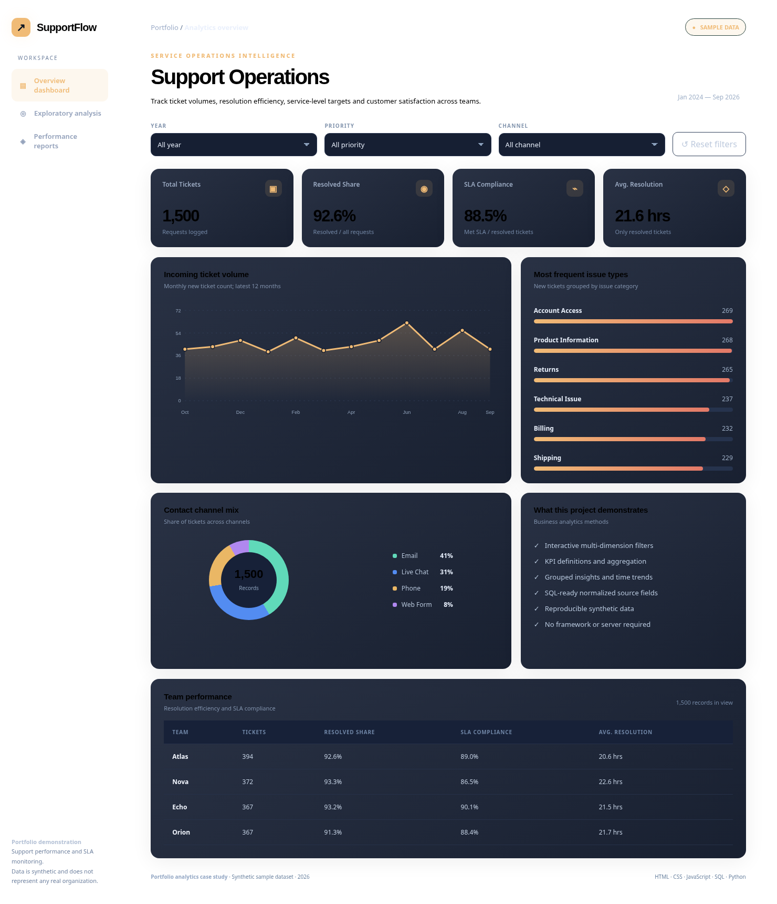

# Customer Support Operations Dashboard

  

A service operations analytics case study for measuring a fictional customer service team's volumes, resolution speed, SLA compliance, and issue mix.

**Business question:** Where are ticket backlogs concentrated and how consistently are service level targets met?

**Key definitions**
- Resolved Share = resolved requests / total requests × 100.
- SLA Compliance = resolved requests meeting their priority SLA / resolved requests × 100. Open requests are excluded.
- Avg. Resolution = mean hours for resolved tickets; excludes open tickets.
- Incoming Ticket Volume = requests grouped by opened month.
- SLA targets by priority: Low 72h, Medium 48h, High 24h, Urgent 8h.

**Dashboard filters:** Year, Priority, and Channel.

**Limitation:** Snapshot is simplified: no reopening, no working-hour calendar, no individual event history, and the numbers are synthetic.

## Preview



## Run locally

1. Download or clone the repository.
2. Open **`index.html`** in any modern browser. It runs offline without installing libraries.
3. Use the dropdown filters and reset control to explore the synthetic sample data.
4. To regenerate the exact sample data and refresh the dashboard, run `python scripts/generate_data.py`.

## Run the SQL analysis

Requires Python 3.9+; uses only the standard library.

```bash
python scripts/analyze.py
```

This builds an ignored `analysis.db` from the included CSV. Then use DB Browser for SQLite to open `analysis.db` and run `sql/analysis.sql`. If you have the SQLite CLI:

```bash
sqlite3 analysis.db < sql/analysis.sql
```

## Files

```text
├── index.html                 # Interactive offline dashboard
├── assets/
│   ├── styles.css            # Responsive design
│   ├── dashboard.js          # KPI + filtering + SVG charts
│   ├── data.js               # Bundled records and dashboard settings
│   └── preview.png           # Example dashboard view
├── data/sample_data.csv      # Synthetic source dataset
├── sql/
│   ├── schema.sql            # SQLite table structure
│   └── analysis.sql          # Business queries
├── scripts/
│   ├── analyze.py            # CSV → SQLite loader
│   └── generate_data.py      # Deterministic synthetic dataset generator
└── README.md
```

## Dataset notice

All rows are **synthetic, generated solely for demonstration**. This is a learning project, not verified business data. The data are not associated with a real company, employees or customers.

## How I would extend this project

- Rebuild the same KPIs as Power BI measures and publish static screenshots.
- Add data-quality validation, documentation, and refresh steps.
- Compare segments over different periods and explain limitations.

## License

MIT — see `LICENSE`.
